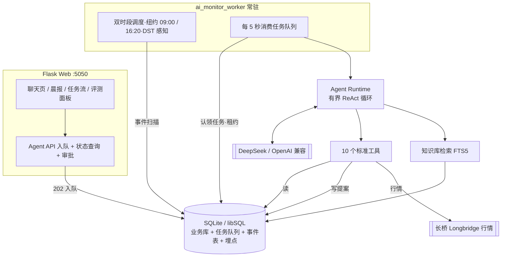

# Investment Tracker — 个人美股投资决策 Agent


一个**自研运行时**的个人美股投资决策 Agent：不止记录投资，还能盯盘、复盘、提出操作建议——但**任何写操作必须经用户批准才执行**。纯 Flask + SQLite + 长桥行情 + OpenAI 兼容大模型（默认 DeepSeek），单机自用，账户数据不出本地。

> 项目由「投资追踪工具」演进而来：P0 单 Agent → P1 事件驱动 → P2 评测闭环，每一阶段都保留了可回溯的设计文档与实现状态（见[文档索引](#文档索引)）。

---

## 它能做什么

| 能力 | 说明 |
|---|---|
| 💬 研究对话 | 自然语言查询持仓、推荐清单、行情、催化剂日历、板块信号；回答前先检索自建投资框架知识库（RAG） |
| 🌅 每日晨报 | 收盘后自动生成：隔夜持仓变化、需关注事项、3 个行动点、数据缺口提示 |
| 📡 事件驱动研判 | 观察项到期自动复盘、财报/事件临近提醒、价格接近触发条件时主动研判 |
| ✍️ 审批闸门 | Agent 提出的录入推荐 / 调整监控 / 发送通知，一律生成审批卡片，**用户批准后才写库** |
| 📊 评测闭环 | 离线冻结数据集评估历史推荐表现 + 在线五指标（完成率 / 审批率 / 工具成功率 / 延迟 / 成本），支持基线对比 |

## 核心设计：写操作闸门

与「聊天机器人」的本质区别在于：**Agent 永远不能直接改你的投资记录**。

```
读工具（7 个） ──────────────▶ 立即执行，返回真实数据
写工具（3 个） ─▶ 参数校验（三档决策门） ─▶ pending_actions 审批卡片
                                        ├─ 用户批准 ─▶ 事务内原子执行
                                        └─ 用户拒绝 ─▶ 按反馈修正重跑（限 1 次）
```

配套护栏：审批超过 24 小时自动失效（防旧价格数据落库）、同一 run 内重复提案去重、同 ticker 活跃记录去重、预算超限 / 进程中断不重放已批准动作、任务租约防多执行器抢占。

## 架构



**关键机制**

- **任务状态机**：`queued → running → waiting_approval → succeeded / rejected → retrying → failed / cancelled`，拒绝重跑不消耗初始 attempt，中断任务由租约超时显式失败（绝不重放可能已提交的写）。
- **事件层**：数据变化扫描为事件（带类型冷却窗口与状态去重），事件分发为工作流任务——同一状态无新证据绝不重复提醒。
- **模型路由**：5 个工作流（研究对话 / 晨报 / 事件研判 / 到期复盘 / 候选研究）各自声明工具权限与模型档位（fast / review / strong），晨报与研判为只读场景，根本不挂载写工具。
- **上下文与成本护栏**：每日 token 预算、单轮迭代上限、运行超时、历史消息字符预算、工具结果截断、LLM 调用重试与降级。

## 为什么不用现成平台 / 编排框架

1. **审批闸门是一等公民**：写操作拦截、三档决策门校验、拒绝后带反馈重跑，这些是产品核心，自研 300 行有界循环比套框架更透明、可测试。
2. **零额外基础设施**：SQLite 表即任务队列与事件总线（`BEGIN IMMEDIATE` + 租约实现并发安全，已启用 WAL），不需要消息队列和编排引擎。
3. **评测埋点原生**：每次运行、每次工具调用（含参数、耗时、结果摘要）全部落库，评测与在线指标直接复用埋点，而不是事后打补丁。

## 快速开始

需要 Python 3.11+，在 `tracker/` 目录操作：

```sh
python -m venv .venv
.venv/bin/pip install -r requirements-dev.txt
cp .env.example .env      # 填入 LLM_API_KEY（必填）、长桥凭证（可选）
```

Web 与 Worker **都要启动**（只启动 Web 时对话会一直排队）：

```sh
.venv/bin/gunicorn --preload --bind 127.0.0.1:5050 --workers 2 --timeout 120 wsgi:app
.venv/bin/python ai_monitor_worker.py
```

或使用 Docker Compose（Web + Worker + 持久卷一键启动）：

```sh
cd tracker && docker compose up --build -d
```

跑测试（临时数据库、禁止真实网络请求、不调用付费模型）：

```sh
.venv/bin/python -m pytest -q
```

更多运维细节（Turso 远端库、数据迁移、调用约定、只读预检 `agent.cli doctor`）见 [tracker/README.md](tracker/README.md)。

## 目录结构

```
├── tracker/
│   ├── app.py                  # Flask 业务 + Agent API（12 个 agent 路由）
│   ├── ai_monitor_worker.py    # 常驻 worker：双时段调度 + 任务消费
│   ├── agent/                  # Agent 包
│   │   ├── runtime.py          # 有界 ReAct 循环 + 预算/租约/审批解析
│   │   ├── tools.py            # 10 个标准工具（7 读 + 3 写）+ 决策门校验
│   │   ├── workflow.py         # 5 个工作流注册表（prompt/权限/模型路由）
│   │   ├── tasks.py / events.py# 任务状态机 / 事件扫描分发
│   │   ├── context.py          # 每轮实时注入的账户上下文
│   │   ├── knowledge.py        # RAG v0：框架文档摄取 + FTS5 检索
│   │   ├── eval.py / metrics.py / quality_eval.py  # 离线评测 / 在线指标 / 输出契约评测
│   │   └── cli.py / preflight.py                  # CLI 与只读预检
│   ├── templates/agent.html   # 聊天页（任务流 + 审批卡片 + 评测面板）
│   └── tests/                 # 127 项自动化测试
├── 供应链瓶颈投资框架.md / AI超级周期轮动框架.md / 动量催化框架.md / NAV折价套利框架.md
│                               # 投资框架（RAG 知识源）
└── 推荐录入与执行闭环规则.md   # 三档决策门等录入规则（RAG 知识源）
```

## 测试与验证

- **127 项自动化测试全部通过**（126 passed / 1 skipped，2026-10-27）：覆盖任务状态机、审批原子性与并发去重、事件冷却、预算与迭代上限、DST 调度、Web 入队不执行等。
- **合成链路验证**：DeepSeek 真实模型完成合成工具调用循环，4/4 合成输出契约案例通过（结论 / 证据引用 / 事实三要素）。
- **只读预检**：`python -m agent.cli doctor [--network]` 检查配置、表结构与行情连接，不初始化、不读持仓、不调模型。

## 已知边界（诚实声明）

- 行情依赖长桥凭证；**未配置时 `get_quotes` 降级返回库内最新快照价并明确标注非实时**，Agent 的判断会相应声明数据缺口。
- 离线评测衡量的是**历史推荐表现**（冻结数据集、成熟窗口、收盘口径），不是模型准确率，更不是收益保证。
- 持仓来自本地同步快照，不含账户现金；模型输出不构成投资建议。
- 成本核算为**估算值**（按配置单价），不等于账单。

## 文档索引

| 文档 | 内容 |
|---|---|
| [tracker/AGENT_P0_DESIGN.md](tracker/AGENT_P0_DESIGN.md) | P0：单 Agent + 工具 + 审批 + RAG 设计 |
| [tracker/AGENT_P1_DESIGN.md](tracker/AGENT_P1_DESIGN.md) | P1：事件驱动 + 工作流 + 任务状态机设计 |
| [tracker/AGENT_P2_DESIGN.md](tracker/AGENT_P2_DESIGN.md) | P2：评测运营体系设计 |
| [tracker/AGENT_IMPLEMENTATION_STATUS.md](tracker/AGENT_IMPLEMENTATION_STATUS.md) | 实现状态、已验收能力与未验收边界（权威） |
| [tracker/README.md](tracker/README.md) | 本地运行 / Docker / 调用约定 / 验证方法 |
| [tracker/MONITORING_REDESIGN.md](tracker/MONITORING_REDESIGN.md) | 价格监控 7 态状态机（P0 之前的历史设计） |

## 演进路线

| 阶段 | 主题 | 状态 |
|---|---|---|
| P0 | 单 Agent + 10 工具 + 写操作全审批 + RAG v0 + 全量埋点 | ✅ 已实现并验收 |
| P1 | 事件驱动 + 5 工作流 + 任务状态机 + 双时段 worker | ✅ 已实现并验收 |
| P2 | 离线评测（冻结数据集 + 基线 diff）+ 在线五指标 | ✅ 已实现并验收 |
| P3 | 平台化（多 Agent 协作 / 多租户 / 长期记忆） | 📋 暂不实现——个人项目没有多业务方复用压力，先把单 Agent 的可靠性做透 |

> AI生成
